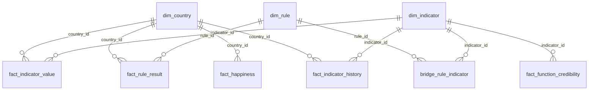

# Power BI guide

The repository does not include a binary `.pbix` (it is not source-friendly).
Instead, `fuzzy-countries export` generates a small star schema as UTF-8 CSV
files, plus this guide and a set of DAX measures. Importing it takes a few
minutes and keeps the report reproducible: when the model or the data changes,
re-run the export and refresh.

## 1. Generate the tables

```bash
fuzzy-countries export --out exports
```

You get:

| File | Rows | Grain |
| --- | ---: | --- |
| `dim_country.csv` | 49 | One row per country. ISO codes, WHR region, coordinates. |
| `dim_indicator.csv` | 28 | One row per indicator. Units, scale, source, membership function and breakpoints. |
| `dim_rule.csv` | 17 | One row per active rule. Description, aggregation, credibility threshold. |
| `bridge_rule_indicator.csv` | 58 | Rule ↔ indicator bridge, including the `negated` flag. |
| `fact_indicator_value.csv` | 1,372 | Country × indicator: raw value, scaled value, truth value, quality flag. |
| `fact_rule_result.csv` | 833 | Country × rule: truth value and rank. |
| `fact_function_credibility.csv` | 26 | Function credibility (`1 - MAE`). |
| `fact_happiness.csv` | 49 | WHR 2021 benchmark. |
| `fact_indicator_history.csv` | 9,575 | Country × indicator × year for renewables, temperature and suicides. |

## 2. Star schema



`bridge_rule_indicator` is a bridge table: it has two many-to-one
relationships (to `dim_rule` and `dim_indicator`) and no direct relationship
between the two dimensions. That avoids an ambiguous filter path.

## 3. Import in Power BI Desktop

1. **Get data → Text/CSV** for each file. Use **Transform Data** rather than
   **Load** so you can set types.
2. Set these types:
   - `country_id`, `indicator_id`, `rule_id`, `year`: **Whole number**.
   - `truth_value`, `raw_value`, `scaled_value`, `expected_scaled`,
     `difference`, `credibility`, `mae`, `ladder_score`: **Decimal number**.
   - `is_consistent`, `negated`, `used_in_rules`: **True/False**.
   - `country`, `indicator`, `label`, `unit`, `region`, `iso3`, `iso2`,
     `description`: **Text**.
3. Create the relationships from the diagram. Set cardinality
   **one-to-many** and a single filter direction from the dimension to the
   fact.
4. Hide the surrogate keys (`country_id`, `indicator_id`, `rule_id`) and the
   `country` column in the fact tables from **Report view**.
5. Sort `dim_indicator[label]` by `indicator` if you prefer stable ordering.

The CSVs are UTF-8 with English column names. If you see `°C` rendered
incorrectly in a Windows console, that is a terminal encoding issue, not a
file issue.

## 4. DAX measures

Create a table called `_Measures` and add:

```dax
Countries = COUNTROWS ( dim_country )

Rules = COUNTROWS ( dim_rule )

Average rule score =
AVERAGE ( fact_rule_result[truth_value] )

Selected rule score =
AVERAGE ( fact_rule_result[truth_value] )

Country rank (selected rule) =
VAR CurrentScore = [Selected rule score]
RETURN
    IF (
        ISBLANK ( CurrentScore ),
        BLANK (),
        RANKX (
            FILTER (
                ALL ( dim_country[country] ),
                NOT ISBLANK ( [Selected rule score] )
            ),
            [Selected rule score],
            ,
            DESC,
            Dense
        )
    )

Top country (selected rule) =
VAR Ranking =
    TOPN (
        1,
        ALLSELECTED ( dim_country[country] ),
        [Selected rule score],
        DESC
    )
RETURN
    CONCATENATEX ( Ranking, dim_country[country], ", " )

Average happiness =
AVERAGE ( fact_happiness[ladder_score] )

Happiness rank (selected country) =
MIN ( fact_happiness[rank] )

Data quality flagged rows =
CALCULATE (
    COUNTROWS ( fact_indicator_value ),
    fact_indicator_value[is_consistent] = FALSE ()
)

Indicator coverage =
DIVIDE (
    COUNTROWS ( fact_indicator_value ),
    COUNTROWS ( dim_country ) * COUNTROWS ( dim_indicator )
)

Average function credibility =
AVERAGE ( fact_function_credibility[credibility] )

History points =
COUNTROWS ( fact_indicator_history )
```

For a selected rule, a table visual with `dim_country[country]` and
`[Selected rule score]` can be sorted descending to get the ranking. Use
`[Country rank (selected rule)]` in a card or table.

## 5. Report pages

### Overview

- **Slicers**: `dim_rule[rule]`, `dim_country[region]`.
- **Cards**: `[Countries]`, `[Rules]`, `[Average rule score]`,
  `[Data quality flagged rows]`.
- **Map**: latitude/longitude from `dim_country`, colour saturation by
  `[Selected rule score]`, tooltip with country, region and score.
- **Bar chart**: top 10 countries by `[Selected rule score]`.

### Rule explorer

- Matrix: rows `dim_country[country]`, columns `dim_rule[rule]`, values
  `AVERAGE(fact_rule_result[truth_value])`, conditional formatting on a
  diverging palette.
- Bar chart: top/bottom 10 for the selected rule.
- Decomposition tree: `dim_rule[rule]` → `dim_country[region]` →
  `dim_country[country]` → `[Selected rule score]`.
- Tooltip: `dim_rule[description]` and `dim_rule[component_count]`.

### Indicator detail

- Scatter: `fact_indicator_value[raw_value]` (X) vs
  `fact_indicator_value[truth_value]` (Y), one point per country, legend by
  indicator, filtered by `dim_indicator[label]`.
- Table: `dim_indicator[label]`, `dim_indicator[unit]`,
  `dim_indicator[function_id]`, `dim_indicator[breakpoints]`.
- Card: `[Average function credibility]`.
- Use `bridge_rule_indicator` in a matrix to show which indicators feed the
  selected rule, with `negated` as a field so you can see `NOT` components.

### Happiness benchmark

- Scatter: `fact_happiness[ladder_score]` (X) vs the selected rule score (Y),
  one point per country.
- Table: country, happiness rank, `[Country rank (selected rule)]`, and the
  difference between the two ranks.
- Add a note that correlation is not causation and that the model uses
  socioeconomic indicators, not survey answers.

### Data quality

- Table filtered to `fact_indicator_value[is_consistent] = FALSE ()`.
- Columns: country, indicator, raw value, scaled value, expected scaled,
  difference, issue.
- Card: `[Data quality flagged rows]`. The current export flags 8 rows; see
  [data_quality.md](data_quality.md) for the explanation.

### Time series

- Line chart: X = `fact_indicator_history[year]`, Y =
  `AVERAGE(fact_indicator_history[value])`, legend =
  `dim_indicator[label]`, small multiples by country.
- Slicers: country, indicator, year range.
- The series is only available for `renewables` (1965-2021),
  `surface_temperature` (1901-2022) and `suicides` (2000-2019). Other
  indicators are 2021 snapshots.

## 6. Refresh workflow

```bash
# 1. Update the model or the raw CSVs
# 2. Rebuild the derived tables
fuzzy-countries build-data --out Data/processed

# 3. Regenerate the Power BI export
fuzzy-countries export --out exports

# 4. In Power BI Desktop: Home > Refresh
```

If the report is published to the Power BI service, put `exports/` in a
OneDrive/SharePoint folder and use the **Folder** connector, or upload the CSVs
to a lakehouse. The table names and keys do not change between runs, so the
report keeps working after a refresh.

## 7. Why not a `.pbix`?

A `.pbix` is a binary container. Committing it would make diffs unreadable and
would hide the transformations. The CSV + documented relationships + DAX
approach is diff-friendly, testable and reproducible. If you need a single
file, build the report once and save the `.pbix` locally; `.gitignore` already
excludes `*.pbix`, `*.pbit` and `*.pbip`.
